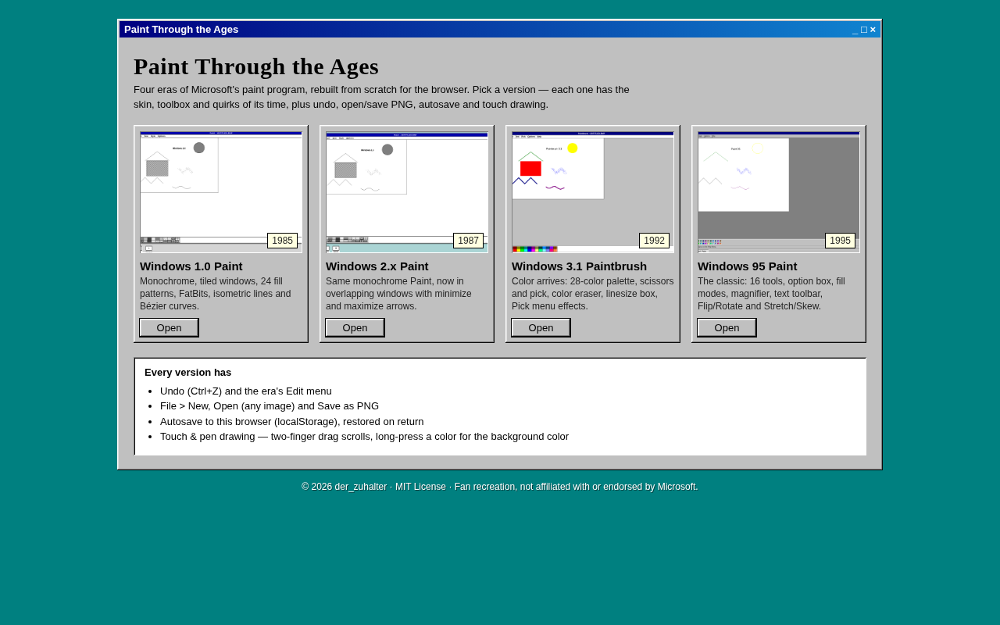
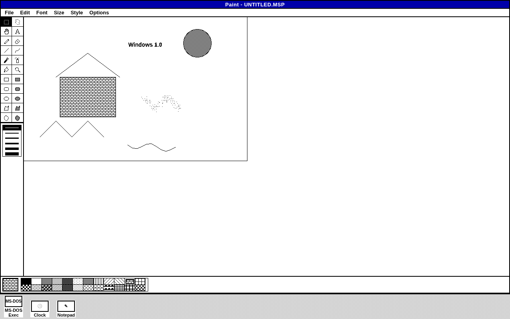
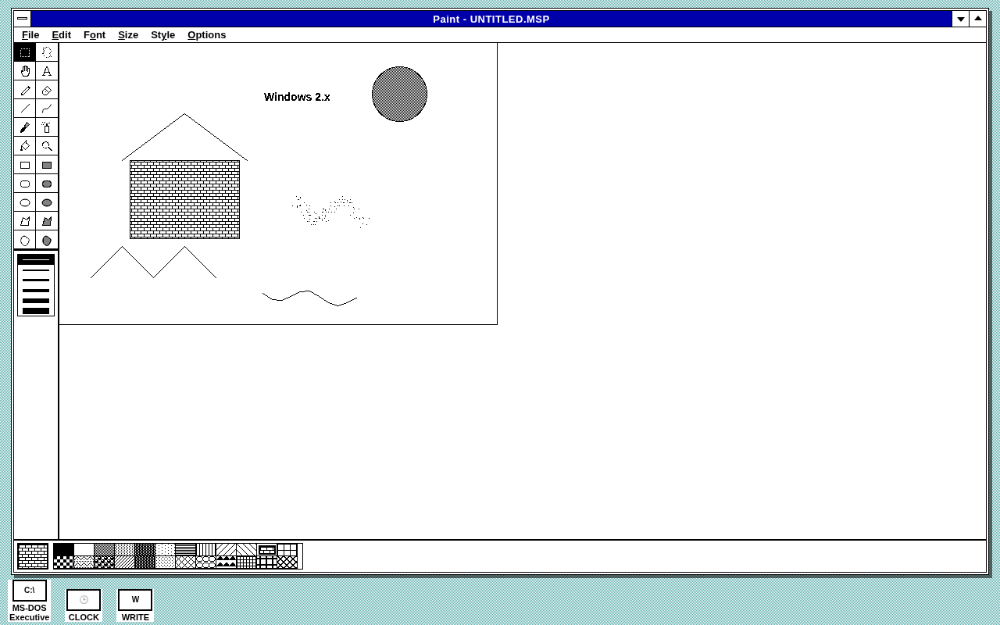
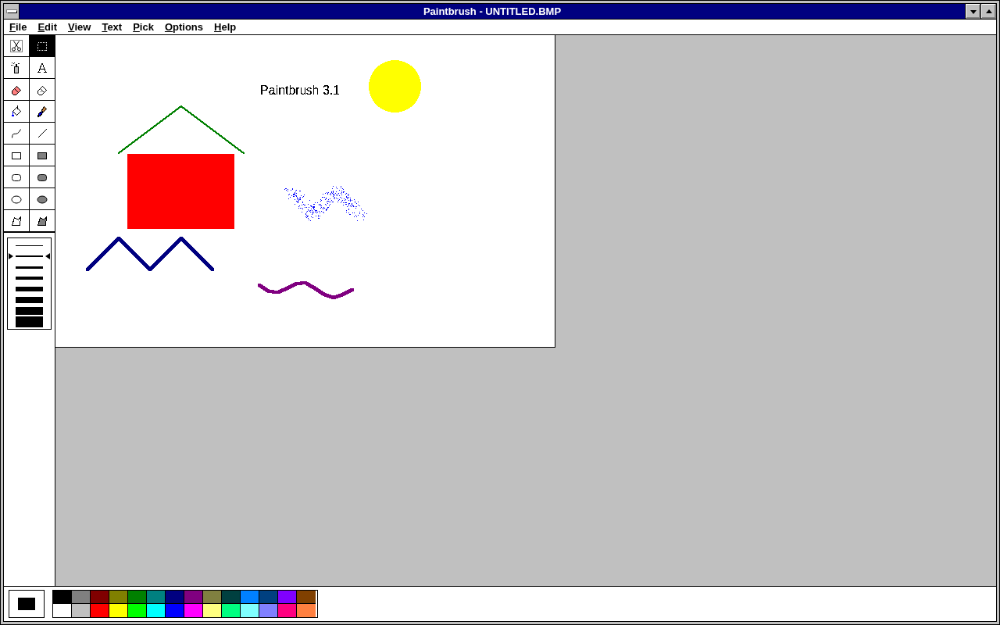
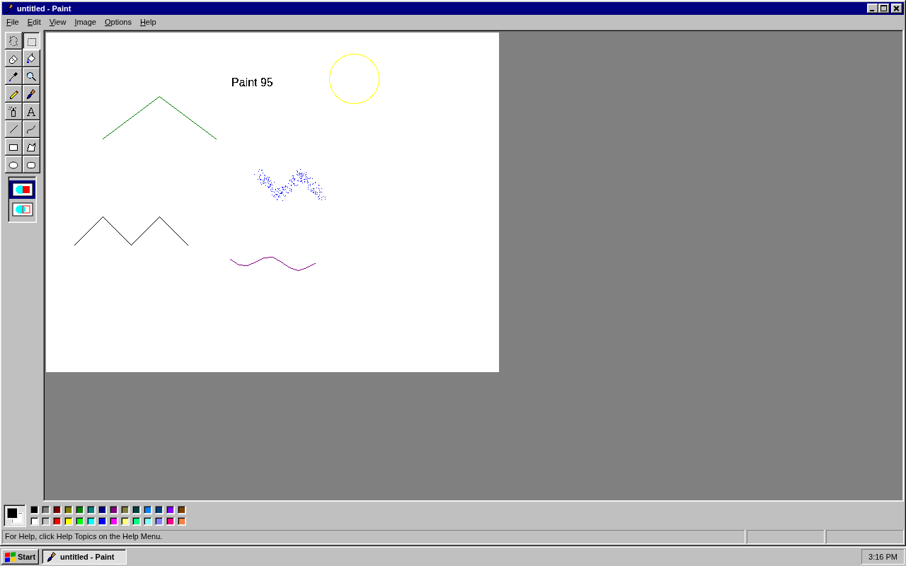
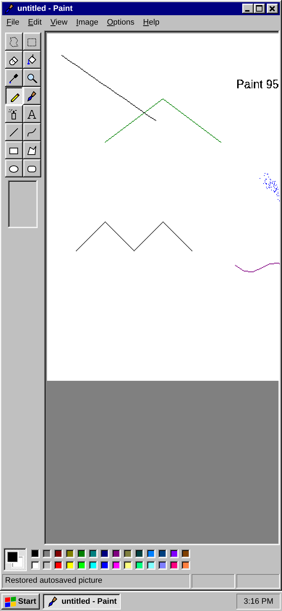
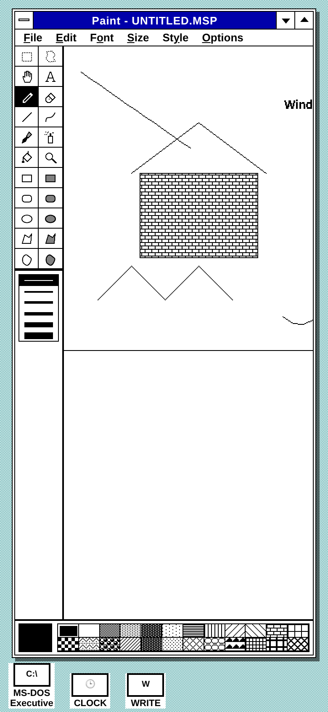

# Paint Through the Ages

Browser clones of MS Paint, from Windows 1.0 to Windows 95. Plain static HTML, CSS and JavaScript with no build step and no dependencies.

**Live:** https://paint-through-the-ages.vercel.app

| Route | Version | |
|---|---|---|
| [`/win1`](https://paint-through-the-ages.vercel.app/win1) | Windows 1.0 Paint (1985) |  |
| [`/win2`](https://paint-through-the-ages.vercel.app/win2) | Windows 2.x Paint (1987) |  |
| [`/win31`](https://paint-through-the-ages.vercel.app/win31) | Windows 3.1 Paintbrush (1992) |  |
| [`/win95`](https://paint-through-the-ages.vercel.app/win95) | Windows 95 Paint (1995) |  |

## Every version has

- The window chrome, menus and toolbox of its era
- Undo (Ctrl+Z) and the era's Edit menu (cut, copy, paste, select all)
- File > New, Open (any image) and Save as PNG
- Autosave to `localStorage`, so the picture is restored when you come back
- Touch and pen drawing: two-finger drag scrolls, and a long-press on a color sets the background color

## Per version

- **Windows 1.0:** tiled windows, black and white only, 24 fill patterns, line widths, brush shapes, FatBits zoom, isometric lines, Bézier curves, invert and trace edges.
- **Windows 2.x:** the same Paint in an overlapping window with the control-menu box and minimize/maximize arrows.
- **Windows 3.1 Paintbrush:** 18 tools (scissors, pick, color eraser, filled shapes), a linesize box, a 28-color palette, and the Pick menu (flip, inverse, shrink + grow, tilt).
- **Windows 95 Paint:** 16 tools with a per-tool options box (eraser and brush sizes, three fill modes, magnifier), a text toolbar, Flip/Rotate, Stretch/Skew, Invert Colors and Attributes.

  
  

## Code layout

- `lib/engine.js`: raster engine where every edit is a plain JSON operation
- `lib/editor.js`: tools, pointer and touch input, selection, undo and autosave
- `lib/app.js`: window chrome, menus, palettes and dialogs
- `lib/profiles.js`: the tools, menus and palette for each era
- `win1/`, `win2/`, `win31/`, `win95/`: the page and skin CSS for each version

To run it locally, serve the folder with any static server (for example `python3 -m http.server`) and open `/win95/`.

## License

MIT © 2026 der_zuhalter. This is a fan recreation and is not affiliated with or endorsed by Microsoft.
